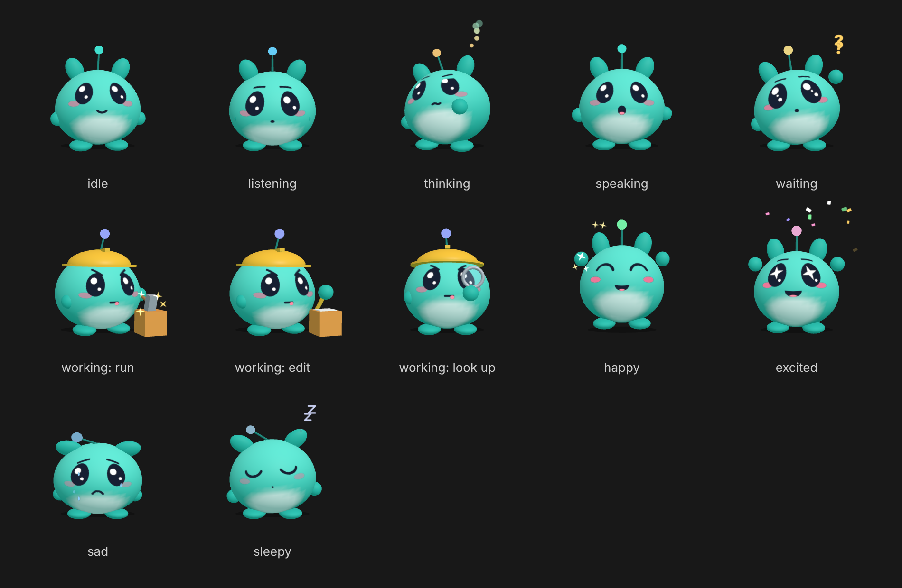
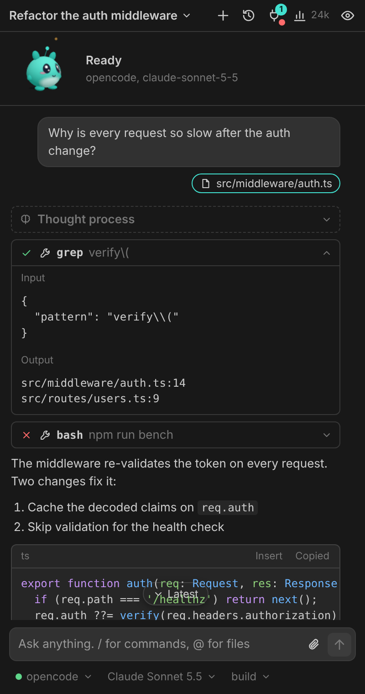
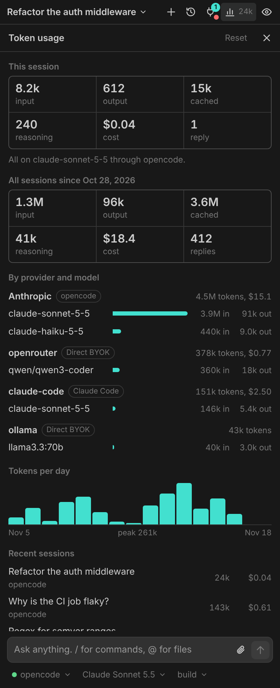
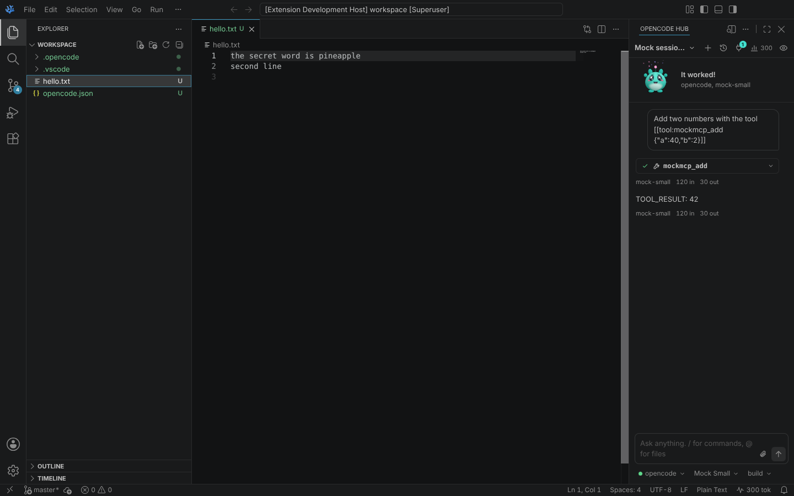
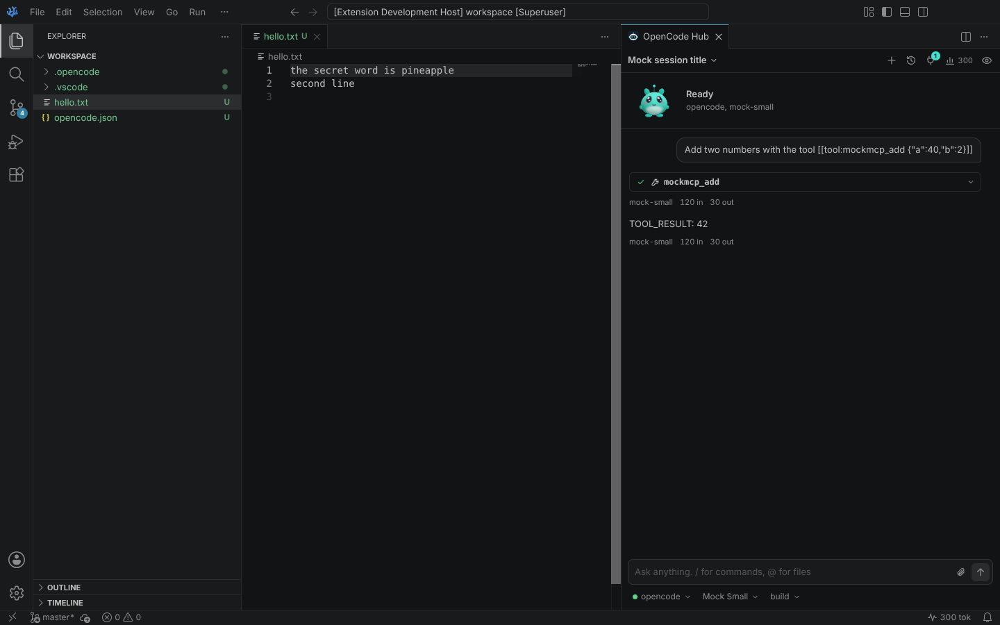
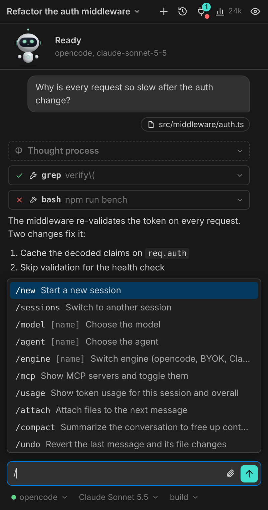
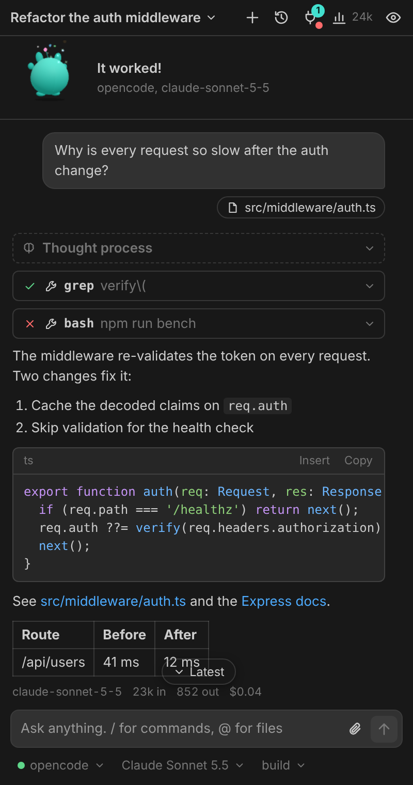
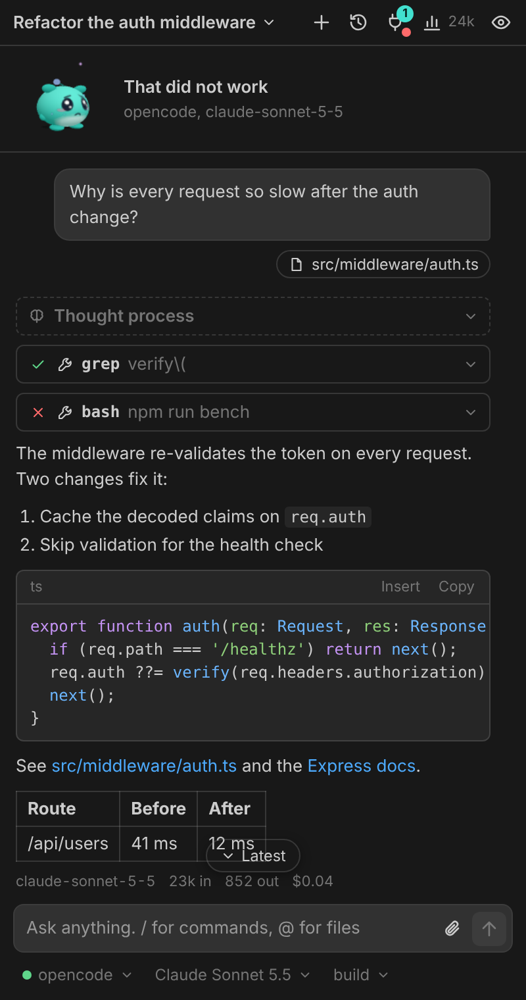
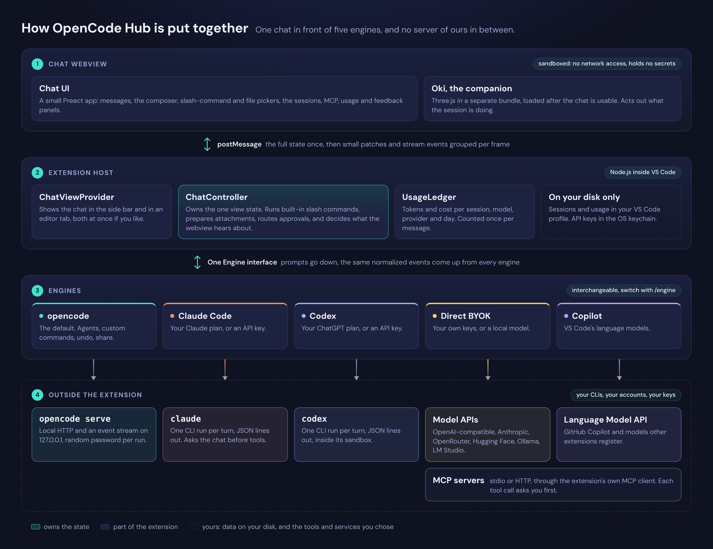

# OpenCode Hub

An open-source chat for VS Code that works with [opencode](https://opencode.ai) first, and also with Claude Code, Codex (ChatGPT), GitHub Copilot, or any OpenAI-compatible or Anthropic model using your own keys.

One chat, five interchangeable engines, and the same features on all of them: sessions, `/commands`, file attachments, MCP server toggles, token usage and cost, and Oki, a 3D companion that shows how the work is going.

Works on **Windows, macOS and Linux**, including remote windows (SSH, WSL, dev containers). No telemetry.



| | |
|---|---|
|  |  |
|  |  |

> This is an independent community project. It is not built by or affiliated with the opencode team, Anthropic, OpenAI, GitHub or Microsoft.

## Contents

| **Get started** | **Daily use** | **Under the hood** | **Project** |
|---|---|---|---|
| [Engines](#engines) | [Slash commands](#slash-commands) | [System design](#system-design) | [Feedback](#feedback) |
| [Install](#install) | [Ask about your code](#ask-about-your-code) | [Sending a message](#what-happens-when-you-send-a-message) | [Development](#development) |
| [Connect an engine](#step-4-connect-an-engine) | [Attachments](#attachments) | [Performance](#performance) | [Tests](#tests) |
| [Where the chat lives](#where-the-chat-lives) | [Sessions](#sessions) | [Settings](#settings) | [Releasing and maintaining](#releasing-and-maintaining) |
| [If something does not work](#if-something-does-not-work) | [Effort](#effort) | [Security and privacy](#security-and-privacy) | [Licence](#licence) |
|  | [Ask or Auto](#ask-or-auto) | [Limits worth knowing](#limits-worth-knowing) |  |
|  | [Questions from the agent](#questions-from-the-agent) |  |  |
|  | [MCP servers](#mcp-servers) |  |  |
|  | [Token usage and cost](#token-usage) |  |  |
|  | [Oki, the companion](#oki-the-companion) |  |  |

## Engines

| Engine | What it uses | Sign-in |
|---|---|---|
| **opencode** (default) | Your installed `opencode` CLI, started as a local server | Any opencode provider: API keys, or subscription logins such as ChatGPT Plus/Pro and GitHub Copilot through `opencode auth login` |
| **Direct BYOK** | OpenAI-compatible and Anthropic APIs called directly | Your API keys, kept in VS Code Secret Storage. Local servers (Ollama, LM Studio, vLLM, llama.cpp) need no key |
| **Claude Code** | Your installed `claude` CLI | Your Claude account (Pro / Max) by default; an Anthropic API key if you choose it |
| **Codex** | Your installed `codex` CLI | Your ChatGPT account (Plus / Pro / Team) by default; an OpenAI API key if you choose it |
| **Copilot / VS Code models** | VS Code's Language Model API | Your GitHub Copilot subscription, plus models other extensions register |

The chat takes the colour of the model's maker, so you always see who you are talking to: a strip along the top of the chat, the message box's border and a dot under the companion turn **orange for Claude**, green for OpenAI, blue for Gemini, purple for Copilot, grey for local models, and so on. It follows the model, not the route: Claude through Copilot or OpenRouter is still orange. `opencodeHub.chat.providerColors` turns it off.

**Your subscription comes first.** Every engine that can sign in with a plan (opencode, Claude Code, Codex, Copilot) offers that before an API key, which is billed per token and is always the last option. Direct BYOK is for API keys and local models only, so its menu starts by pointing you to the engines that use your plan.

Switch at any time with `/engine` or the engine button under the message box. Each engine keeps its own sessions and model choice per folder, and the history shows all of them (see [Sessions](#sessions)).

## Install

Installing takes about two minutes; connecting an engine takes a few more.

### What you need

- **VS Code 1.98 or newer** (check under *Help → About*) on Windows, macOS or Linux. Editors built on that version or later, such as Cursor, VSCodium and Windsurf, can install it too.
- **At least one engine** from the table above. You can add more later.
- **Node.js** only if you install a CLI with `npm` or build the extension yourself.

| Platform | Tested in CI |
|---|---|
| Windows | Unit tests, the engines against the real CLIs, and the extension inside VS Code |
| macOS | Unit tests, the engines against the real CLIs, and the extension inside VS Code |
| Linux, including WSL, SSH and dev containers | Every suite, on the oldest supported VS Code and the current one |

The extension is one platform-independent package with no native modules, so the same file installs everywhere. In a remote window it runs on the remote machine, next to your code and your CLIs.

### Step 1: Install the extension

**From the Extensions view (recommended)**

1. Open the Extensions view: `Ctrl+Shift+X` (`Cmd+Shift+X` on macOS).
2. Search for **OpenCode Hub**.
3. Click **Install**.

Or run this in a terminal: `code --install-extension rohit-chandra.opencode-hub`

If your editor's gallery does not list it yet, install the `.vsix` file instead (Step 2).

### Step 2: Or install from a `.vsix` file

Skip this step if Step 1 worked. Get the file one of these ways:

- **Download a release.** Open the [Releases page](https://github.com/rohit-chandra/opencode-vs-code-extension/releases), expand *Assets* under the newest version and download `opencode-hub-<version>.vsix`.
- **Download a CI build.** Open the [Actions tab](https://github.com/rohit-chandra/opencode-vs-code-extension/actions), choose the latest green *CI* run and download the `opencode-hub-vsix` artifact. Unzip it to get `opencode-hub.vsix`.
- **Build it yourself** (Node.js 22):

  ```bash
  git clone https://github.com/rohit-chandra/opencode-vs-code-extension.git
  cd opencode-vs-code-extension
  npm ci
  npm run package        # writes opencode-hub.vsix in this folder
  ```

Then install it: in the Extensions view, click the **…** menu, choose **Install from VSIX…** and select the file. Or run **Extensions: Install from VSIX…** from the Command Palette, or use a terminal:

```bash
code --install-extension opencode-hub-0.6.0.vsix
```

Use `cursor`, `codium` or `windsurf` in place of `code` for those editors. If `code` is not found on macOS, run *Shell Command: Install 'code' command in PATH* from the Command Palette first. On Windows, quote the path if it contains spaces: `code --install-extension "D:\Downloads\opencode-hub-0.6.0.vsix"`.

### Step 3: Open the chat

Click the Oki icon in the activity bar, or press `Ctrl+Alt+O` (`Cmd+Alt+O` on macOS). You can also run **OpenCode Hub: Open Chat** from the Command Palette.

The first time, VS Code may ask whether you trust the folder. Chat only works in trusted folders, because engines run programs and can change files.

**OpenCode Hub: Get Started** in the Command Palette opens a short walkthrough of the steps below.

### Step 4: Connect an engine

You need one of these. The chat tells you when the selected engine is missing and what to install.

<details open>
<summary><b>opencode</b> (the default)</summary>

1. Install the CLI:

   ```bash
   npm install -g opencode-ai
   ```

   Other install methods are listed on [opencode.ai](https://opencode.ai).
2. Check that it runs: `opencode --version`
3. Connect a model provider. Type `/providers` in the chat and choose **Sign in with a subscription**, then your plan: ChatGPT Plus/Pro, GitHub Copilot, GitLab Duo or another one opencode supports. A terminal opens straight at that sign-in and your browser asks you to confirm. Or run it yourself in any terminal:

   ```bash
   opencode auth login
   ```

   The models appear in the chat as soon as the sign-in finishes, wherever you started it; no restart is needed. An API key (billed per token) is the last option in the same menu, for providers without a subscription sign-in.
4. Choose a model with the model button under the message box.

The extension looks for the CLIs on your `PATH` and in the usual install locations (Homebrew, nvm, Volta, fnm, asdf, mise, pnpm, bun, `~/.local/bin`, npm's global folder on Windows, and more), so an editor started from the macOS Dock or a Linux launcher finds them too. If `opencode` is installed somewhere else, set `opencodeHub.opencode.path` to the full path of the executable. `/doctor` shows what was found.

</details>

<details>
<summary><b>Direct BYOK</b>: your own API key, or a local model</summary>

1. Type `/engine` in the chat and choose **Direct BYOK**.
2. Type `/providers`, choose a provider (OpenAI, Anthropic, OpenRouter, Hugging Face, Google Gemini, Groq, Mistral, DeepSeek, xAI, Together AI, Ollama or LM Studio) and paste your API key. Keys go to VS Code Secret Storage, not to settings files.
3. Choose a model with the model button.

**Hugging Face** has three entries:

- **Hugging Face**: open models from the Hub (Qwen, Llama, DeepSeek, gpt-oss, Kimi and more) through [Inference Providers](https://huggingface.co/docs/inference-providers), with one Hugging Face token. Create a fine-grained token with *Make calls to Inference Providers* at huggingface.co/settings/tokens. `HF_TOKEN` or `HUGGINGFACE_HUB_TOKEN` in your environment also works. Model ids look like `Qwen/Qwen3-Coder-480B-A35B-Instruct`; add `:fastest`, `:cheapest` or a provider name (`:together`) to choose where it runs.
- **Hugging Face Inference Endpoint**: your own dedicated endpoint. You paste its URL and your token.
- **Hugging Face TGI (local)**: Text Generation Inference on `localhost:8080`, no key.

With the **opencode** engine, Hugging Face is also in opencode's own provider list (`/providers`, then *Connect an opencode provider*).

For a local server such as Ollama or LM Studio, start the server first; no key is needed. Any other OpenAI-compatible endpoint can be added under `opencodeHub.providers` (see [Settings](#settings)).

</details>

<details>
<summary><b>Claude Code</b></summary>

1. `npm install -g @anthropic-ai/claude-code`
2. In the chat: `/engine`, then **Claude Code**.
3. Click **Sign in with Claude**. A terminal runs `claude auth login --claudeai` and your browser opens; sign in with your Claude account. The chat notices when you are done.

The model picker lists the models your Claude plan includes, as Claude Code reports them for your account (for example Fable 5.2, Opus 5.5, Sonnet 5.5, Haiku 5.5). The list follows your account: it is fetched again after you sign in, after the first reply, and whenever the window gets the focus back after a sign-in elsewhere.

After that list come the entries Claude Code accepts but may leave out for your account: any of the Fable, Opus, Sonnet and Haiku families that is missing, and **Opus Plan Mode** (Opus while planning, Sonnet for the rest). For anything else, such as an earlier version, click **Add a model by name…** at the bottom of the picker and type its id (for example `claude-opus-5`); it is kept in `opencodeHub.claudeCode.models`. If your plan does not include a model, Claude's reply says so.

Your Claude Pro or Max plan is used, not per-token API billing. In this mode the extension also hides `ANTHROPIC_API_KEY` from the CLI, so a key set in your shell for other tools cannot quietly take over. To use an API key instead, click **Use an API key instead** (or `/login`); the key is kept in VS Code Secret Storage. `/login` switches back at any time.

</details>

<details>
<summary><b>Codex</b> (ChatGPT)</summary>

1. `npm install -g @openai/codex`
2. In the chat: `/engine`, then **Codex (ChatGPT)**.
3. Click **Sign in with ChatGPT**. A terminal runs `codex login` and your browser opens; sign in with your ChatGPT account. On a remote machine (SSH, WSL, a container) use **Use a device code** instead.

The model picker lists the models of your ChatGPT plan, as `codex app-server` reports them, with *Default* (your `config.toml` model or Codex's recommended one) first.

Your ChatGPT Plus or Pro plan is used, not per-token API billing; `CODEX_API_KEY` is hidden from the CLI in this mode. If Codex was signed in with an API key earlier, the chat says so and offers the ChatGPT sign-in. **Use an API key instead** (or `/login`) switches to a key kept in VS Code Secret Storage.

</details>

<details>
<summary><b>GitHub Copilot</b> and other VS Code models</summary>

1. Install the GitHub Copilot Chat extension and sign in.
2. In the chat: `/engine`, then **Copilot / VS Code models**.
3. The first message makes VS Code ask whether OpenCode Hub may use Copilot's models. Choose **Allow**.

</details>

### Step 5: Check that it works

1. Type `hello` and press `Enter`. Oki starts thinking and the reply streams in.
2. Type `/` to see the commands, and `@` to attach a file from the workspace.
3. Click the plug icon to see your MCP servers and the chart icon for token usage.
4. Type `/doctor` to see which engines are installed and ready on this machine.

### Updating and removing

- **Update:** VS Code updates extensions from the Marketplace by itself. With a `.vsix`, install the newer file the same way. Sessions, keys and usage statistics are kept either way.
- **Remove:** in the Extensions view, find *OpenCode Hub*, click the gear and choose **Uninstall**. From a terminal: `code --uninstall-extension rohit-chandra.opencode-hub`.

### If something does not work

| What you see | What to do |
|---|---|
| *Engine not available* and a sad Oki | The CLI for that engine was not found or did not start. Install it (Step 4), or set its path in settings, then run **OpenCode Hub: Restart Active Engine** |
| *No model available* | Run `/providers` and connect a provider, then pick a model |
| The chat says the workspace is not trusted | Run **Workspaces: Manage Workspace Trust** and trust the folder |
| Nothing happens after installing | Run **Developer: Reload Window** |
| An engine is installed but shows as missing | Type `/doctor`. If the CLI is not found, set its path in settings (`opencodeHub.opencode.path`, `.claudeCode.path`, `.codex.path`) |
| Anything else | Run **OpenCode Hub: Show Logs**. The log shows how each engine was started and what it answered. `/feedback` reports it to the maintainers |

## Where the chat lives

The chat can sit on the left, on the right, or in an editor tab, and you can change your mind at any time. VS Code remembers the choice.

| | |
|---|---|
|  |  |
| On the right, next to the editor | As an editor tab |

| You want | Do this |
|---|---|
| Chat on the **right** (secondary side bar) | Run **OpenCode Hub: Move Chat to the Right (Secondary Side Bar)**, type `/move right`, or use the **…** menu of the chat view |
| Chat back on the **left** | **OpenCode Hub: Move Chat to the Left (Primary Side Bar)** or `/move left` |
| Chat as an **editor tab** | The *Open Chat in an Editor Tab* button in the chat's title bar, or `/move editor`. A tab can be split, dragged beside your code, or moved to its own window like any other editor |
| A **wider or narrower** chat | Drag the border between the chat and the editor. The layout follows the width, and long lines stay readable because the conversation column stops growing at 880 px |
| **Bigger or smaller text** | `Ctrl+Alt+=` and `Ctrl+Alt+-` (`Cmd` on macOS), `Ctrl+Alt+0` to reset, or `/zoom 125%`. Range 80% to 160%, saved in `opencodeHub.chat.zoom` |

Moving to the right with one command needs a VS Code version that lets extensions add views to the secondary side bar; it is tested on 1.143. On older versions (tested on 1.98) the same command opens VS Code's *Move View* picker, where you choose *New Secondary Side Bar Entry*. Dragging the Oki icon from the activity bar into the secondary side bar works on every version.

The side bar view and the editor tab can be open at the same time. Both show the same conversation.

## Features

### Slash commands

Type `/` to see every command, filtered as you type. Commands defined by the engine (opencode custom commands and skills, Claude Code commands) appear in the same list.



| Command | What it does |
|---|---|
| `/new`, `/clear` | Start a new session |
| `/sessions` | Search and switch sessions, rename or delete them |
| `/context [title]` | Bring another session into this chat as condensed context |
| `/model [name]`, `/agent [name]`, `/engine [name]` | Change model, agent or engine |
| `/effort [level\|default]` | How hard the model thinks (see [Effort](#effort)) |
| `/mcp` | Show MCP servers with their status and a toggle each |
| `/usage` | Token usage for this session and overall |
| `/attach` | Attach files |
| `/login` | Claude Code and Codex: sign in with your Claude / ChatGPT account, use an API key, or sign out |
| `/providers` | Connect providers and manage API keys |
| `/compact`, `/undo`, `/redo`, `/share`, `/unshare`, `/fork` | Session tools, where the engine supports them |
| `/rename <title>`, `/export` | Rename the session, or save it as Markdown |
| `/stop` | Stop the current response (`Esc` also works) |
| `/move [left\|right\|editor]` | Put the chat on the left, on the right, or in an editor tab |
| `/zoom [in\|out\|reset\|125%]` | Change the chat's text size |
| `/avatar [on\|off\|buddy\|dots]` | Show, hide or restyle the companion |
| `/doctor` | Versions, your system and the state of every engine |
| `/feedback [bug\|idea\|other] [text]` | Report a bug or share an idea (opens a pre-filled GitHub issue) |
| `/help` | List all commands |

Output of `/help` and `/doctor` is a card with a close button; it is not part of the conversation and is never sent to the model.

### Ask about your code

- Select code, right-click, then **Explain Selection** or **Fix Selection**. The selection is attached and the question is sent in one step.
- On an error or warning, open the lightbulb (`Ctrl+.`) and choose **Fix with OpenCode Hub**. The lines around the problem and the message from the compiler or linter go to the chat. The lightbulb entry appears once the chat has been opened in the window; turn it off with `opencodeHub.editor.quickFix`.
- With opencode, Claude Code and Codex the agent edits the file. Direct BYOK and Copilot answer with the corrected code.

### Retry and recent models

- When a reply fails, or you stop it, a **Retry** button appears under it. It sends your last message again (attachments are not re-sent).
- The model picker lists the models you used most recently for the current engine at the top, above the full list by provider.

### Effort

Models that can think harder or lighter get an effort button next to the model name. It opens the levels that model has, lightest first, each with a line on what it trades: for example **Low**, **Medium**, **High**, **Extra high** and **Max**. Higher levels give more thorough answers, take longer, and use up a plan's limits (or tokens) faster; the top level says so in the menu and tints the button. **Default** leaves the choice to the model.

The levels are never guessed for an account: they are the ones the engine reports for the model you picked.

| Engine | Where the levels come from | How the choice is sent |
|---|---|---|
| Claude Code | The CLI's model list for your account | `claude --effort <level>` |
| Codex | The CLI's model list (with its own descriptions and default) | `model_reasoning_effort` |
| opencode | The model's *variants* | The prompt's `variant` |
| Direct BYOK | Low, medium and high for OpenAI-compatible APIs; low to max for Anthropic's | `reasoning_effort`, or `output_config.effort` |
| Copilot | VS Code's model API has no such setting | No button |

`/effort high` sets a level by name, `/effort default` clears it, and `/effort` alone shows what the model has. The choice is kept per engine; a model without that level uses its own default until you switch back. A BYOK endpoint does not say which of its models take the setting, so when one refuses a level the message is sent again without it and the chat says so once.

### Attachments

- **The file you have open** appears as a dashed chip above the message box (its selected lines, when you have a selection). Click it to add it, like Copilot's *current file*.
- Type `@` to search workspace files and attach one.
- Use the paperclip, or drop files on the chat (hold `Shift` when dragging from the Explorer, a VS Code requirement).
- Paste an image from the clipboard.
- Select code and press `Ctrl+Alt+L`, or right-click → **Add Selection to Chat**.

### Sessions

The history button (or `/sessions`) lists your saved sessions. **All engines** shows every engine's sessions for this folder in one list, newest first, each labelled with its engine; opening one switches to that engine. The other tab shows only the current engine. After a restart the chat opens on the engine and session you were last using, even in a window with no folder open.

**Everything stays on your computer.** Nothing is uploaded anywhere by the extension.

| Engine | Where sessions are kept |
|---|---|
| opencode | opencode's own storage (`~/.local/share/opencode`), managed by opencode |
| Claude Code, Codex, Direct BYOK, Copilot | Your VS Code profile folder (`globalStorage/rohit-chandra.opencode-hub/sessions/`), one JSON file per session, readable only by your user account on macOS and Linux (Windows keeps it in your private profile folder). Claude Code and Codex also keep their own transcripts as usual |

- **Saved as you go.** A conversation is written when you send a message and every few seconds while the reply streams, so closing VS Code mid-reply keeps it. Claude Code and Codex conversations can be continued after a restart.
- **Memory stays flat.** Listing reads a small index of titles and dates; a conversation's messages are read from disk when you open it, and only the last few opened stay in memory.
- **Carry context into a new chat, when you want it.** A new session starts clean. To build on an older one, click the link icon next to it in the sessions list, or type `/context`. A condensed copy (what you asked, what was answered and which tools ran; no tool output) is attached to your next message as a chip you can remove. It works across engines, calls no model and costs nothing until you send it.
- **Old sessions are cleaned up.** Sessions not used for 30 days are deleted when VS Code starts, like Claude Code's default. Change it with `opencodeHub.sessions.keepDays` (`0` keeps everything). opencode's sessions follow opencode's own rules.

### Ask or Auto

The shield button under the message box chooses whether the agent asks before it acts.

- **Ask** (default): commands, file edits and tool calls wait for **Allow once**, **Always allow** or **Deny**.
- **Auto**: the agent proceeds without asking, like the Claude app's auto mode. The button turns into a yellow **Auto** so you can see it.

Switch with the button, `/auto` and `/ask`, **Switch to Auto** on any approval card, or *OpenCode Hub: Toggle Auto Mode*. The choice is a user setting (`opencodeHub.approvals`), so a workspace's settings cannot turn Auto on.

| Engine | What Ask does | What Auto does |
|---|---|---|
| opencode | Shows opencode's permission requests | Approves them as they arrive |
| Claude Code | Claude Code asks the chat before each tool its permission mode does not already allow (`acceptEdits` allows file edits) | Approves every tool call |
| Direct BYOK, Copilot | Asks before each MCP tool call | Runs MCP tools without asking |
| Codex | Codex never stops to ask; `opencodeHub.codex.sandbox` limits what it can do | Same |

### Questions from the agent

When a request is vague, or a decision is yours to make, the model can ask before it goes on. Its questions appear above the message box **one at a time**: pick one of the options (several where the question allows it), or **type an answer of your own** in the box under them. **Next** moves on, **Back** changes an earlier answer, and nothing is sent until the last question is answered. **Skip** tells the model to carry on with its own judgement.

Questions are not approvals, so they are shown in Auto mode too.

| Engine | How the model asks |
|---|---|
| opencode | opencode's question tool |
| Claude Code | Claude's `AskUserQuestion` tool, in every permission mode |
| Direct BYOK, Copilot | A small `ask_user` tool the extension offers to the model. `opencodeHub.chat.askQuestions` turns it off; a model that takes no tools simply goes without it |
| Codex | No question tool in this mode: it asks in plain text and you answer in the chat |

### MCP servers

The plug icon shows how many MCP servers are connected. Open it to see each server's status and switch servers on or off.

| Engine | Where servers are defined | What the toggle does |
|---|---|---|
| opencode | `mcp` in `opencode.json` | Connects or disconnects the server in the running opencode instance |
| Direct BYOK, Copilot | `opencodeHub.mcp.servers` in VS Code settings | Connects or disconnects the extension's own MCP client. Tool calls ask for your approval |
| Claude Code | `.mcp.json`, `~/.claude.json` | Starts the CLI with only the enabled servers |
| Codex | `~/.codex/config.toml` | Passes `mcp_servers.<name>.enabled` for each run |

```jsonc
// settings.json — MCP servers for the Direct BYOK and Copilot engines
"opencodeHub.mcp.servers": {
  "filesystem": { "command": "npx", "args": ["-y", "@modelcontextprotocol/server-filesystem", "${workspaceFolder}"] },
  "docs": { "url": "https://example.com/mcp", "headers": { "Authorization": "Bearer ${env:DOCS_TOKEN}" } }
}
```

`${workspaceFolder}` and `${env:NAME}` are expanded in `command`, `args`, `env`, `cwd`, `url` and `headers`.

### Token usage

Every reply records input, output, reasoning and cached tokens, plus cost when the engine reports it.

- Under each reply: tokens in and out for that reply, and its cost. Hover for the model and the full breakdown.
- Next to the model under the message box: what the **open session** has cost so far, with its tokens (in a narrow side bar the dollars are shown and the tokens move to the tooltip). Hover for tokens in and out and the number of replies; click to open the usage panel. The status bar shows the same total.
- `/usage`: this session with a **per-reply breakdown** (model, tokens in and out, cost of each reply), all sessions, a breakdown by provider and model across every engine, tokens per day and recent sessions.
- The sessions list shows each session's total.

- In the corner of the message box: a ring that fills as the conversation approaches the model's context window. It turns into a warning with a percentage at 75% and again at 90%, and its tooltip gives the numbers. The figure comes from the last reply, so treat it as an estimate.

Statistics are stored locally in VS Code and survive restarts. *OpenCode Hub: Reset Token Usage Statistics* clears them.

**Where the dollars come from**

| Engine | Cost |
|---|---|
| opencode, Claude Code | Reported by the engine for every reply |
| Direct BYOK: OpenRouter | Reported by the provider with each reply |
| Direct BYOK: OpenAI, Anthropic, Gemini, Groq, Mistral, DeepSeek, xAI, Together AI, Hugging Face | Estimated from the provider's public list price for the model |
| Codex | Estimated from OpenAI's list price for the model |
| Direct BYOK: Ollama, LM Studio and other local or custom endpoints | None, unless you add prices under `pricing` in `opencodeHub.providers` |
| Copilot | None. Copilot does not report usage, so even the token numbers are estimates from the model's tokenizer |

Estimates use a price table that ships with the extension (it is refreshed with each release, and nothing is downloaded while you work), so a price that changed last week can be off until the next update. With a subscription (a ChatGPT plan in Codex, a Claude plan in Claude Code) you are not billed per token: the figure is what the same tokens would cost through the API. Prices you set under `pricing` always win, and `opencodeHub.usage.estimateCost` turns estimates off.

### Oki, the companion

Oki is a small 3D character that lives at the top of the chat and acts out what the session is doing, so you can tell how things are going without reading the log.

| When | Oki | Status line |
|---|---|---|
| Nothing is happening | Breathes, blinks and looks around | *Ready* |
| You are typing | Leans in with raised brows | *Listening* |
| The model has not answered yet | Looks up with a hand on its chin, thought bubbles rise | *Thinking…* |
| Text is streaming | Mouth moves in time with the incoming text | *Writing…* |
| A tool is running | Puts on a hard hat and gets to work: a hammer for commands and builds, a pencil for edits, a magnifier for searches and reads | *Running bash…*, *Editing with edit…*, *Looking with grep…* |
| A tool finished | A quick hop and a sparkle | |
| A tool failed | A wince | |
| The agent needs your approval | Waves at you under a question mark | *Needs your OK* |
| The turn ended and tools succeeded | Jumps, spins and throws confetti | *It worked!* |
| The turn ended without tools | Smiles with closed eyes | *Done* |
| The turn ended with an error, or the last tool failed | Droops, tears up, antenna hangs | *That did not work* |
| Three minutes without activity | Falls asleep | *Resting* |

| | |
|---|---|
|  |  |

- **Click Oki** to poke it. The small button beside it switches between the character and a minimal **dots** style that shows the same moods with five dots. `/avatar buddy` and `/avatar dots` do the same.
- **Hide it** with the eye icon or `/avatar off`.
- It is drawn with Three.js in a separate bundle that loads after the chat is usable. It stops rendering when the chat is hidden, slows down when idle, honours the *reduce motion* setting, and falls back to a flat drawing when WebGL is not available.

Oki is an original character made for this project.

## How it works

### System design



The extension has three layers:

1. **The chat webview** is a small Preact app. It holds no secrets and cannot reach the network; everything it knows arrives as messages from the extension host. Oki is a second bundle that the webview loads once the chat is on screen.
2. **The chat controller** owns the one view state: the session list, the open conversation, models, MCP servers, pending approvals and usage. It runs the built-in slash commands, prepares attachments and decides what the webview needs to hear about.
3. **Engines** hide the differences between backends. Each one implements the same `Engine` interface and translates its backend's stream into the same events (`message.updated`, `part.delta`, `session.status`, `usage` and a few more), so the UI and the usage statistics never contain engine-specific code.

| Engine | How it talks to its backend | Who keeps the sessions |
|---|---|---|
| opencode | Starts `opencode serve` on `127.0.0.1` with a random password (or attaches to a server you run), sends requests over HTTP and listens to its event stream | opencode |
| Direct BYOK | Calls `/chat/completions` or Anthropic's `/v1/messages` directly and streams the answer. Runs MCP tools itself, asking you before each call | The extension |
| Claude Code | Runs `claude -p` with JSON-lines output for each turn and resumes the same CLI session on the next one | The extension, mirroring the CLI's session |
| Codex | Runs `codex exec --json` for each turn and resumes the same thread | The extension, mirroring the CLI's thread |
| Copilot / VS Code models | Uses VS Code's Language Model API, with the same MCP tool loop as Direct BYOK | The extension |

### What happens when you send a message


A few details that matter:

- **Streaming sends differences, not documents.** The host and the webview run the same reducer over the same events, so a long reply is never re-sent as a whole.
- **Usage is counted once.** The ledger is keyed by message id. Reloading history or receiving the same update twice changes nothing.
- **Approvals travel the same path.** When opencode asks for a permission, Claude Code calls its permission-prompt tool, or an MCP tool is about to run in Direct BYOK or Copilot, the engine emits a request, the chat shows it, and your answer goes back to the engine. In Auto mode the answer is "allow" straight away.
- **MCP toggles go to whoever owns the servers.** For opencode that is the running opencode instance; for Direct BYOK and Copilot it is the extension's own MCP client; Claude Code and Codex get the enabled set as start-up arguments.

More detail, including how to add an engine, is in [docs/ARCHITECTURE.md](docs/ARCHITECTURE.md).

## Feedback

The extension has no telemetry, so the maintainers only know about a problem when you tell them.

- Type `/feedback`, run **OpenCode Hub: Send Feedback or Report a Problem…**, or click **Report a problem** under a reply that failed.
- Choose *Bug*, *Idea* or *Other*, write a few lines and press **Continue on GitHub**. A pre-filled issue opens in your browser; you review it there and press Submit. Nothing is sent before that.
- **GitHub says *Unable to create issue*?** Then that browser is signed in with a company-managed GitHub account (the page shows "Users managed by …"), and GitHub does not let those accounts post outside their company. Use **Copy link** in the form, or `/feedback link` afterwards, and open the link in a private window or another browser where you use a personal GitHub account.
- Diagnostics are optional and you see them first: the versions of the extension and the editor, your operating system, and which engines are ready. Prompts, files, paths and keys are never included.

What happens next: a maintainer reads the issue. For something the project's Claude agent can fix, the maintainer adds the `claude-fix` label; the agent then reproduces the problem, fixes it on a branch and opens a pull request that a human reviews before it is merged. [docs/MAINTAINING.md](docs/MAINTAINING.md) describes the set-up.

## Performance

The chat is built to stay out of the editor's way.

- **Fast start.** The extension activates only when you open the chat or run one of its commands. The chat bundle is about 230 KB; the 3D companion is a separate bundle that loads when the browser is idle.
- **Smooth streaming.** Tokens are grouped on the extension side and applied once per animation frame. Markdown is parsed block by block, and only the block that is still growing is parsed again. Finished messages are not re-rendered at all.
- **Long conversations.** Messages that are off screen are skipped by the browser's layout (`content-visibility`). Large model lists are capped and searched as you type.
- **A cheap companion.** Oki renders only when something moves: about 60 frames per second during a celebration, fewer when idle, and none when the chat is hidden or out of view. Its face is redrawn only when the expression changes.

Measured with the UI test suite (headless Chrome, software rendering): a reply streamed as 977 chunks (11.7 KB of Markdown with code blocks) is on screen in about 1.2 seconds at 60 frames per second with no long tasks. Before these changes the same reply took about 7.8 seconds. `npm run test:ui` repeats the measurement and fails if streaming gets slow again.

## Settings

| Setting | Default | Purpose |
|---|---|---|
| `opencodeHub.defaultEngine` | `opencode` | Engine for new workspaces |
| `opencodeHub.opencode.path` | | Path to `opencode` if it is not on `PATH` |
| `opencodeHub.opencode.serverUrl` | | Attach to a running `opencode serve` instead of starting one |
| `opencodeHub.opencode.serverPassword` | | Password of that server |
| `opencodeHub.sessions.keepDays` | `30` | Delete saved sessions unused for this many days (`0` keeps them) |
| `opencodeHub.approvals` | `ask` | `ask` before the agent acts, or `auto` to proceed without asking (user setting only) |
| `opencodeHub.providers` | `[]` | Direct BYOK providers (no keys here) |
| `opencodeHub.mcp.servers` | `{}` | MCP servers for Direct BYOK and Copilot |
| `opencodeHub.claudeCode.auth` | `subscription` | `subscription` (your Claude account) or `apiKey` (a key in Secret Storage) |
| `opencodeHub.claudeCode.path`, `.permissionMode`, `.models` | `acceptEdits` | Claude Code CLI location, permission mode, extra model names |
| `opencodeHub.codex.auth` | `subscription` | `subscription` (your ChatGPT account) or `apiKey` (a key in Secret Storage) |
| `opencodeHub.codex.path`, `.sandbox`, `.models` | `workspace-write` | Codex CLI location, sandbox policy, extra model names |
| `opencodeHub.avatar.enabled`, `.style` | `true`, `buddy` | Companion on/off, and `buddy` (the character) or `dots` |
| `opencodeHub.chat.zoom` | `1` | Text size of the chat, from `0.8` to `1.6` |
| `opencodeHub.chat.providerColors` | `true` | Colour the chat by the model's maker (Claude orange, OpenAI green, …) |
| `opencodeHub.chat.askQuestions` | `true` | Direct BYOK and Copilot: let the model ask you clarifying questions through the chat |
| `opencodeHub.usage.statusBar` | `true` | Session tokens in the status bar |
| `opencodeHub.usage.estimateCost` | `true` | Estimate cost from list prices when the engine reports none |
| `opencodeHub.direct.maxContextTokens` | `0` | Direct BYOK: cap on conversation history per request. `0` trims only when the provider says the context window is full |
| `opencodeHub.editor.quickFix` | `true` | Offer *Fix with OpenCode Hub* in the lightbulb menu |
| `opencodeHub.systemPrompt` | | Extra instructions for Direct BYOK and Copilot |

A custom provider looks like this:

```jsonc
"opencodeHub.providers": [
  { "id": "my-vllm", "type": "openai-compatible", "baseUrl": "http://gpu-box:8000/v1", "models": ["qwen3-coder"] },
  { "id": "openrouter", "type": "openai-compatible", "baseUrl": "https://openrouter.ai/api/v1",
    "pricing": { "qwen/qwen3-coder": { "input": 0.2, "output": 0.8 } } }
]
```

## Security and privacy

- API keys for Direct BYOK, and for Claude Code or Codex in API-key mode, live in VS Code Secret Storage (your OS keychain), never in settings files. Account logins (Claude, ChatGPT, opencode) stay with each CLI; the extension only asks the CLI whether it is signed in (`claude auth status`, `codex login status`) and does not read the credentials.
- The opencode server the extension starts listens on `127.0.0.1` only and is protected with a random password for each run.
- Your prompts and attachments go only to the engine and model you selected. The extension has no telemetry and makes no other network requests. Feedback opens a pre-filled GitHub issue in your browser, which you submit yourself.
- Model output is sanitized before it is shown. The chat view loads no remote content.
- In an untrusted workspace no engine is started and chat is off, because engines run executables, load project configuration (MCP servers, plugins) and can run tools. Engine settings stored in the workspace (CLI paths, providers, MCP servers) are ignored there.
- Tool permissions: in Ask mode, opencode permission requests, Claude Code tool calls and MCP tool calls in Direct BYOK and Copilot are shown for approval. Claude Code's requests come through a small MCP server the extension writes to its storage folder and gives the CLI with `--permission-prompt-tool`; it talks only to `127.0.0.1` with a random token per turn. Codex runs non-interactively, so what it may do is set by `codex.sandbox`. In Auto mode everything is approved without asking.

## Limits worth knowing

- Codex cannot ask for approval mid-run; choose its sandbox in settings.
- The Direct BYOK and Copilot engines are chat with MCP tools. They do not edit files on their own; use opencode, Claude Code or Codex for agentic coding.
- Direct BYOK keeps a long conversation going by leaving the oldest turns out of the request once the provider reports that the context window is full (the chat tells you when that starts). It does not summarize them. Local servers that cut long prompts silently need `opencodeHub.direct.maxContextTokens`.
- A new session does not remember earlier ones on its own. Use `/context` to bring one in, or keep lasting instructions in the files your engine reads (`AGENTS.md`, `CLAUDE.md`).
- Sharing, undo and compaction are available where the engine has them (opencode has all three).

## Development

```bash
npm ci
npm run build          # bundle extension + webview into dist/
npm run watch          # rebuild on change, then press F5 in VS Code
npm run lint && npm run typecheck
npm run package        # → opencode-hub.vsix
npm run diagrams       # re-render the README diagrams from docs/diagrams/*.html
npm run prices         # refresh the bundled list prices (needs the opencode CLI)
npm run stats          # installs and downloads on the Marketplace, Open VSX and GitHub
```

### Tests

| Command | What runs |
|---|---|
| `npm test` | Unit tests |
| `npm run test:e2e` | Engines and the chat controller against the **real** `opencode`, `claude` and `codex` CLIs, each pointed at a local mock model server. Suites skip when a CLI is not installed |
| `npm run test:ui` | The real webview bundle in headless Chrome, with screenshots in `test-results/ui/` |
| `npm run test:integration` | The extension inside a real VS Code (Linux: `xvfb-run -a npm run test:integration`) |

To run everything locally: `npm i -g opencode-ai @anthropic-ai/claude-code @openai/codex`. No account is needed for any of the tests.

See [docs/ARCHITECTURE.md](docs/ARCHITECTURE.md) for how the pieces fit together and [CONTRIBUTING.md](CONTRIBUTING.md) for how to add an engine.

## Releasing and maintaining

Publish a GitHub release with a tag `vX.Y.Z` that matches `version` in `package.json`. The release workflow tests, packages and attaches the `.vsix`, and publishes to the Visual Studio Marketplace and Open VSX when they are set up. [docs/MAINTAINING.md](docs/MAINTAINING.md) covers the one-time Marketplace set-up, where to see how many people use the extension, and the Claude agent that fixes issues.

## Licence

MIT. Bundled third-party packages and their licences are listed in `dist/THIRD_PARTY_NOTICES.txt` inside the extension.
