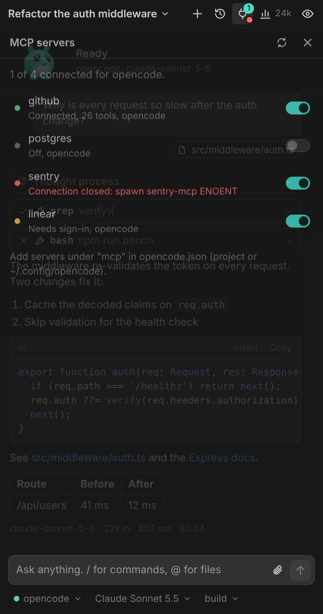
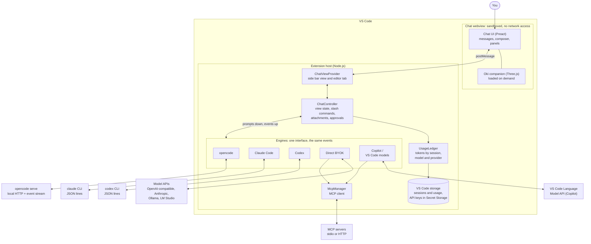
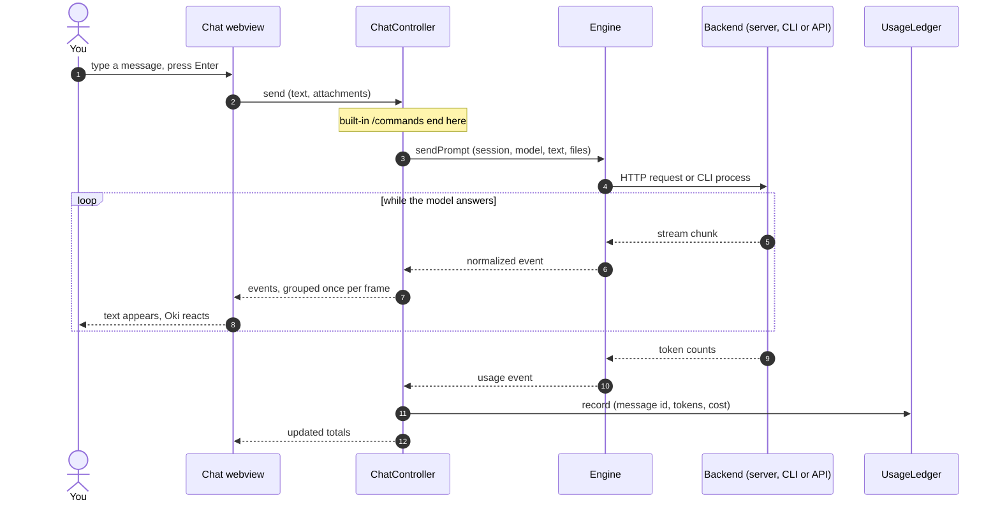

# OpenCode Hub

An open-source chat for VS Code that works with [opencode](https://opencode.ai) first, and also with Claude Code, Codex (ChatGPT), GitHub Copilot, or any OpenAI-compatible or Anthropic model using your own keys.

One chat, five interchangeable engines, and the same features on all of them: sessions, `/commands`, file attachments, MCP server toggles, token usage statistics, and Oki, a 3D companion that shows how the work is going.


| | |
|---|---|
|  |  |
|  |  |

> This is an independent community project. It is not built by or affiliated with the opencode team, Anthropic, OpenAI, GitHub or Microsoft.

**Contents:** [Engines](#engines) · [Install](#install) · [Where the chat lives](#where-the-chat-lives) · [Features](#features) · [How it works](#how-it-works) · [Performance](#performance) · [Settings](#settings) · [Security and privacy](#security-and-privacy) · [Development](#development)

## Engines

| Engine | What it uses | Sign-in |
|---|---|---|
| **opencode** (default) | Your installed `opencode` CLI, started as a local server | Any opencode provider: API keys, or subscription logins such as ChatGPT Plus/Pro and GitHub Copilot through `opencode auth login` |
| **Direct BYOK** | OpenAI-compatible and Anthropic APIs called directly | Your API keys, kept in VS Code Secret Storage. Local servers (Ollama, LM Studio, vLLM, llama.cpp) need no key |
| **Claude Code** | Your installed `claude` CLI | Whatever that CLI is signed in with (Claude subscription or API key) |
| **Codex** | Your installed `codex` CLI | Whatever that CLI is signed in with (ChatGPT subscription or API key) |
| **Copilot / VS Code models** | VS Code's Language Model API | Your GitHub Copilot subscription, plus models other extensions register |

Switch at any time with `/engine` or the engine button under the message box. Each engine keeps its own sessions and model choice per workspace.

## Install

The extension is one `.vsix` file. Installing it takes about two minutes; connecting an engine takes a few more.

### What you need

- **VS Code 1.98 or newer** (check under *Help → About*). Editors built on that version or later, such as Cursor, VSCodium and Windsurf, can install it too.
- **At least one engine** from the table above. You can add more later.
- **Node.js** only if you install a CLI with `npm` or build the extension yourself.

### Step 1: Get the `.vsix` file

Pick one:

- **Download a release.** Open the [Releases page](https://github.com/rohit-chandra/opencode-vs-code-extension/releases), expand *Assets* under the newest version and download `opencode-hub-<version>.vsix`.
- **Download a CI build.** Open the [Actions tab](https://github.com/rohit-chandra/opencode-vs-code-extension/actions), choose the latest green *CI* run and download the `opencode-hub-vsix` artifact. Unzip it to get `opencode-hub.vsix`.
- **Build it yourself** (Node.js 22):

  ```bash
  git clone https://github.com/rohit-chandra/opencode-vs-code-extension.git
  cd opencode-vs-code-extension
  npm ci
  npm run package        # writes opencode-hub.vsix in this folder
  ```

### Step 2: Install it in VS Code

Any of these does the same thing.

**From the Extensions view**

1. Open the Extensions view: `Ctrl+Shift+X` (`Cmd+Shift+X` on macOS).
2. Click the **…** menu at the top of the view.
3. Choose **Install from VSIX…**
4. Select the `.vsix` file you downloaded.
5. When VS Code shows *Completed installing*, choose **Reload Window** if it offers to.

**From the Command Palette**

1. Press `Ctrl+Shift+P` (`Cmd+Shift+P` on macOS).
2. Run **Extensions: Install from VSIX…** and select the file.

**From a terminal**

```bash
code --install-extension opencode-hub-0.2.0.vsix
```

Use `cursor`, `codium` or `windsurf` in place of `code` for those editors. If `code` is not found on macOS, run *Shell Command: Install 'code' command in PATH* from the Command Palette first. On Windows, quote the path if it contains spaces: `code --install-extension "D:\Downloads\opencode-hub-0.2.0.vsix"`.

### Step 3: Open the chat

Click the Oki icon in the activity bar, or press `Ctrl+Alt+O` (`Cmd+Alt+O` on macOS). You can also run **OpenCode Hub: Open Chat** from the Command Palette.

The first time, VS Code may ask whether you trust the folder. Chat only works in trusted folders, because engines run programs and can change files.

### Step 4: Connect an engine

You need one of these. The chat tells you when the selected engine is missing and what to install.

<details open>
<summary><b>opencode</b> (the default)</summary>

1. Install the CLI:

   ```bash
   npm install -g opencode-ai
   ```

   Other install methods are listed on [opencode.ai](https://opencode.ai).
2. Check that it runs: `opencode --version`
3. Connect a model provider. Either type `/providers` in the chat, or run this in a terminal and follow the prompts:

   ```bash
   opencode auth login
   ```

   This is also where subscription logins (for example ChatGPT or GitHub Copilot) are set up, when your opencode version offers them.
4. Back in VS Code, run **OpenCode Hub: Restart Active Engine**, then choose a model with the model button under the message box.

If `opencode` is installed somewhere VS Code cannot find, set `opencodeHub.opencode.path` to the full path of the executable.

</details>

<details>
<summary><b>Direct BYOK</b>: your own API key, or a local model</summary>

1. Type `/engine` in the chat and choose **Direct BYOK**.
2. Type `/providers`, choose a provider (OpenAI, Anthropic, OpenRouter, Google Gemini, Groq, Mistral, DeepSeek, xAI, Together AI, Ollama or LM Studio) and paste your API key. Keys go to VS Code Secret Storage, not to settings files.
3. Choose a model with the model button.

For a local server such as Ollama or LM Studio, start the server first; no key is needed. Any other OpenAI-compatible endpoint can be added under `opencodeHub.providers` (see [Settings](#settings)).

</details>

<details>
<summary><b>Claude Code</b></summary>

1. `npm install -g @anthropic-ai/claude-code`
2. Run `claude` once in a terminal and sign in.
3. In the chat: `/engine`, then **Claude Code**.

</details>

<details>
<summary><b>Codex</b> (ChatGPT)</summary>

1. `npm install -g @openai/codex`
2. Run `codex login` in a terminal.
3. In the chat: `/engine`, then **Codex (ChatGPT)**.

</details>

<details>
<summary><b>GitHub Copilot</b> and other VS Code models</summary>

1. Install the GitHub Copilot Chat extension and sign in.
2. In the chat: `/engine`, then **Copilot / VS Code models**.
3. The first message makes VS Code ask whether OpenCode Hub may use Copilot's models. Choose **Allow**.

</details>

### Step 5: Check that it works

1. Type `hello` and press `Enter`. Oki starts thinking and the reply streams in.
2. Type `/` to see the commands, and `@` to attach a file from the workspace.
3. Click the plug icon to see your MCP servers and the chart icon for token usage.

### Updating and removing

- **Update:** install the newer `.vsix` the same way. It replaces the old version; sessions, keys and usage statistics are kept.
- **Remove:** in the Extensions view, find *OpenCode Hub*, click the gear and choose **Uninstall**. From a terminal: `code --uninstall-extension rohit-chandra.opencode-hub`.

### If something does not work

| What you see | What to do |
|---|---|
| *Engine not available* and a sad Oki | The CLI for that engine was not found or did not start. Install it (Step 4), or set its path in settings, then run **OpenCode Hub: Restart Active Engine** |
| *No model available* | Run `/providers` and connect a provider, then pick a model |
| The chat says the workspace is not trusted | Run **Workspaces: Manage Workspace Trust** and trust the folder |
| Nothing happens after installing | Run **Developer: Reload Window** |
| Anything else | Run **OpenCode Hub: Show Logs**. The log shows how each engine was started and what it answered |

## Where the chat lives

The chat can sit on the left, on the right, or in an editor tab, and you can change your mind at any time. VS Code remembers the choice.

| | |
|---|---|
|  |  |
| On the right, next to the editor | As an editor tab |

| You want | Do this |
|---|---|
| Chat on the **right** (secondary side bar) | Run **OpenCode Hub: Move Chat to the Right (Secondary Side Bar)**, type `/move right`, or use the **…** menu of the chat view |
| Chat back on the **left** | **OpenCode Hub: Move Chat to the Left (Primary Side Bar)** or `/move left` |
| Chat as an **editor tab** | The *Open Chat in an Editor Tab* button in the chat's title bar, or `/move editor`. A tab can be split, dragged beside your code, or moved to its own window like any other editor |
| A **wider or narrower** chat | Drag the border between the chat and the editor. The layout follows the width, and long lines stay readable because the conversation column stops growing at 880 px |
| **Bigger or smaller text** | `Ctrl+Alt+=` and `Ctrl+Alt+-` (`Cmd` on macOS), `Ctrl+Alt+0` to reset, or `/zoom 125%`. Range 80% to 160%, saved in `opencodeHub.chat.zoom` |

Moving to the right with one command needs a VS Code version that lets extensions add views to the secondary side bar; it is tested on 1.143. On older versions (tested on 1.98) the same command opens VS Code's *Move View* picker, where you choose *New Secondary Side Bar Entry*. Dragging the Oki icon from the activity bar into the secondary side bar works on every version.

The side bar view and the editor tab can be open at the same time. Both show the same conversation.

## Features

### Slash commands

Type `/` to see every command, filtered as you type. Commands defined by the engine (opencode custom commands and skills, Claude Code commands) appear in the same list.


| Command | What it does |
|---|---|
| `/new`, `/clear` | Start a new session |
| `/sessions` | Search and switch sessions, rename or delete them |
| `/model [name]`, `/agent [name]`, `/engine [name]` | Change model, agent or engine |
| `/mcp` | Show MCP servers with their status and a toggle each |
| `/usage` | Token usage for this session and overall |
| `/attach` | Attach files |
| `/providers` | Connect providers and manage API keys |
| `/compact`, `/undo`, `/redo`, `/share`, `/unshare`, `/fork` | Session tools, where the engine supports them |
| `/rename <title>`, `/export` | Rename the session, or save it as Markdown |
| `/stop` | Stop the current response (`Esc` also works) |
| `/move [left\|right\|editor]` | Put the chat on the left, on the right, or in an editor tab |
| `/zoom [in\|out\|reset\|125%]` | Change the chat's text size |
| `/avatar [on\|off\|buddy\|dots]` | Show, hide or restyle the companion |
| `/help` | List all commands |

### Attachments

- Type `@` to search workspace files and attach one.
- Use the paperclip, or drop files on the chat (hold `Shift` when dragging from the Explorer, a VS Code requirement).
- Paste an image from the clipboard.
- Select code and press `Ctrl+Alt+L`, or right-click → **Add Selection to Chat**.

### MCP servers

The plug icon shows how many MCP servers are connected. Open it to see each server's status and switch servers on or off.

| Engine | Where servers are defined | What the toggle does |
|---|---|---|
| opencode | `mcp` in `opencode.json` | Connects or disconnects the server in the running opencode instance |
| Direct BYOK, Copilot | `opencodeHub.mcp.servers` in VS Code settings | Connects or disconnects the extension's own MCP client. Tool calls ask for your approval |
| Claude Code | `.mcp.json`, `~/.claude.json` | Starts the CLI with only the enabled servers |
| Codex | `~/.codex/config.toml` | Passes `mcp_servers.<name>.enabled` for each run |

```jsonc
// settings.json — MCP servers for the Direct BYOK and Copilot engines
"opencodeHub.mcp.servers": {
  "filesystem": { "command": "npx", "args": ["-y", "@modelcontextprotocol/server-filesystem", "${workspaceFolder}"] },
  "docs": { "url": "https://example.com/mcp", "headers": { "Authorization": "Bearer ${env:DOCS_TOKEN}" } }
}
```

`${workspaceFolder}` and `${env:NAME}` are expanded in `command`, `args`, `env`, `cwd`, `url` and `headers`.

### Token usage

Every reply records input, output, reasoning and cached tokens, plus cost when the engine reports it.

- Under each reply: tokens in and out for that reply.
- Under the message box and in the status bar: the running total for the session.
- `/usage`: this session, all sessions, a breakdown by provider and model across every engine, tokens per day and recent sessions.

Statistics are stored locally in VS Code and survive restarts. *OpenCode Hub: Reset Token Usage Statistics* clears them.

Costs come from the engine when it reports them (opencode, Claude Code, and providers that return a cost with their usage, such as OpenRouter). For other BYOK providers you can add prices per million tokens under `pricing` in `opencodeHub.providers`. Copilot does not report usage, so its numbers are estimates from the model's tokenizer.

### Oki, the companion

Oki is a small 3D character that lives at the top of the chat and acts out what the session is doing, so you can tell how things are going without reading the log.

| When | Oki | Status line |
|---|---|---|
| Nothing is happening | Breathes, blinks and looks around | *Ready* |
| You are typing | Leans in with raised brows | *Listening* |
| The model has not answered yet | Looks up with a hand on its chin, thought bubbles rise | *Thinking…* |
| Text is streaming | Mouth moves in time with the incoming text | *Writing…* |
| A tool is running | Puts on a hard hat and gets to work: a hammer for commands and builds, a pencil for edits, a magnifier for searches and reads | *Running bash…*, *Editing with edit…*, *Looking with grep…* |
| A tool finished | A quick hop and a sparkle | |
| A tool failed | A wince | |
| The agent needs your approval | Waves at you under a question mark | *Needs your OK* |
| The turn ended and tools succeeded | Jumps, spins and throws confetti | *It worked!* |
| The turn ended without tools | Smiles with closed eyes | *Done* |
| The turn ended with an error, or the last tool failed | Droops, tears up, antenna hangs | *That did not work* |
| Three minutes without activity | Falls asleep | *Resting* |

| | |
|---|---|
|  |  |

- **Click Oki** to poke it. The small button beside it switches between the character and a minimal **dots** style that shows the same moods with five dots. `/avatar buddy` and `/avatar dots` do the same.
- **Hide it** with the eye icon or `/avatar off`.
- It is drawn with Three.js in a separate bundle that loads after the chat is usable. It stops rendering when the chat is hidden, slows down when idle, honours the *reduce motion* setting, and falls back to a flat drawing when WebGL is not available.

Oki is an original character made for this project.

## How it works

### System design



The extension has three layers:

1. **The chat webview** is a small Preact app. It holds no secrets and cannot reach the network; everything it knows arrives as messages from the extension host. Oki is a second bundle that the webview loads once the chat is on screen.
2. **The chat controller** owns the one view state: the session list, the open conversation, models, MCP servers, pending approvals and usage. It runs the built-in slash commands, prepares attachments and decides what the webview needs to hear about.
3. **Engines** hide the differences between backends. Each one implements the same `Engine` interface and translates its backend's stream into the same events (`message.updated`, `part.delta`, `session.status`, `usage` and a few more), so the UI and the usage statistics never contain engine-specific code.

| Engine | How it talks to its backend | Who keeps the sessions |
|---|---|---|
| opencode | Starts `opencode serve` on `127.0.0.1` with a random password (or attaches to a server you run), sends requests over HTTP and listens to its event stream | opencode |
| Direct BYOK | Calls `/chat/completions` or Anthropic's `/v1/messages` directly and streams the answer. Runs MCP tools itself, asking you before each call | The extension |
| Claude Code | Runs `claude -p` with JSON-lines output for each turn and resumes the same CLI session on the next one | The extension, mirroring the CLI's session |
| Codex | Runs `codex exec --json` for each turn and resumes the same thread | The extension, mirroring the CLI's thread |
| Copilot / VS Code models | Uses VS Code's Language Model API, with the same MCP tool loop as Direct BYOK | The extension |

### What happens when you send a message



A few details that matter:

- **Streaming sends differences, not documents.** The host and the webview run the same reducer over the same events, so a long reply is never re-sent as a whole.
- **Usage is counted once.** The ledger is keyed by message id. Reloading history or receiving the same update twice changes nothing.
- **Approvals travel the same path.** When opencode asks for a permission, or an MCP tool is about to run in Direct BYOK or Copilot, the engine emits a request, the chat shows it, and your answer goes back to the engine.
- **MCP toggles go to whoever owns the servers.** For opencode that is the running opencode instance; for Direct BYOK and Copilot it is the extension's own MCP client; Claude Code and Codex get the enabled set as start-up arguments.

More detail, including how to add an engine, is in [docs/ARCHITECTURE.md](docs/ARCHITECTURE.md).

## Performance

The chat is built to stay out of the editor's way.

- **Fast start.** The extension activates only when you open the chat or run one of its commands. The chat bundle is about 230 KB; the 3D companion is a separate bundle that loads when the browser is idle.
- **Smooth streaming.** Tokens are grouped on the extension side and applied once per animation frame. Markdown is parsed block by block, and only the block that is still growing is parsed again. Finished messages are not re-rendered at all.
- **Long conversations.** Messages that are off screen are skipped by the browser's layout (`content-visibility`). Large model lists are capped and searched as you type.
- **A cheap companion.** Oki renders only when something moves: about 60 frames per second during a celebration, fewer when idle, and none when the chat is hidden or out of view. Its face is redrawn only when the expression changes.

Measured with the UI test suite (headless Chrome, software rendering): a reply streamed as 977 chunks (11.7 KB of Markdown with code blocks) is on screen in about 1.2 seconds at 60 frames per second with no long tasks. Before these changes the same reply took about 7.8 seconds. `npm run test:ui` repeats the measurement and fails if streaming gets slow again.

## Settings

| Setting | Default | Purpose |
|---|---|---|
| `opencodeHub.defaultEngine` | `opencode` | Engine for new workspaces |
| `opencodeHub.opencode.path` | | Path to `opencode` if it is not on `PATH` |
| `opencodeHub.opencode.serverUrl` | | Attach to a running `opencode serve` instead of starting one |
| `opencodeHub.opencode.serverPassword` | | Password of that server |
| `opencodeHub.providers` | `[]` | Direct BYOK providers (no keys here) |
| `opencodeHub.mcp.servers` | `{}` | MCP servers for Direct BYOK and Copilot |
| `opencodeHub.claudeCode.path`, `.permissionMode`, `.models` | `acceptEdits` | Claude Code CLI location, permission mode, extra model names |
| `opencodeHub.codex.path`, `.sandbox`, `.models` | `workspace-write` | Codex CLI location, sandbox policy, extra model names |
| `opencodeHub.avatar.enabled`, `.style` | `true`, `buddy` | Companion on/off, and `buddy` (the character) or `dots` |
| `opencodeHub.chat.zoom` | `1` | Text size of the chat, from `0.8` to `1.6` |
| `opencodeHub.usage.statusBar` | `true` | Session tokens in the status bar |
| `opencodeHub.systemPrompt` | | Extra instructions for Direct BYOK and Copilot |

A custom provider looks like this:

```jsonc
"opencodeHub.providers": [
  { "id": "my-vllm", "type": "openai-compatible", "baseUrl": "http://gpu-box:8000/v1", "models": ["qwen3-coder"] },
  { "id": "openrouter", "type": "openai-compatible", "baseUrl": "https://openrouter.ai/api/v1",
    "pricing": { "qwen/qwen3-coder": { "input": 0.2, "output": 0.8 } } }
]
```

## Security and privacy

- API keys for Direct BYOK live in VS Code Secret Storage (your OS keychain), never in settings files. opencode, Claude Code and Codex keep their own credentials; the extension does not read them.
- The opencode server the extension starts listens on `127.0.0.1` only and is protected with a random password for each run.
- Your prompts and attachments go only to the engine and model you selected. The extension has no telemetry and makes no other network requests.
- Model output is sanitized before it is shown. The chat view loads no remote content.
- In an untrusted workspace no engine is started and chat is off, because engines run executables, load project configuration (MCP servers, plugins) and can run tools. Engine settings stored in the workspace (CLI paths, providers, MCP servers) are ignored there.
- Tool permissions: opencode permission requests and MCP tool calls in Direct BYOK and Copilot are shown for approval. Claude Code and Codex run non-interactively, so what they may do is set by `claudeCode.permissionMode` and `codex.sandbox`.

## Limits worth knowing

- Claude Code and Codex cannot ask for approval mid-run in this version; choose their permission mode and sandbox in settings.
- The Direct BYOK and Copilot engines are chat with MCP tools. They do not edit files on their own; use opencode, Claude Code or Codex for agentic coding.
- Direct BYOK does not trim long conversations. Start a new session when a chat gets close to the model's context window.
- Sharing, undo and compaction are available where the engine has them (opencode has all three).

## Development

```bash
npm ci
npm run build          # bundle extension + webview into dist/
npm run watch          # rebuild on change, then press F5 in VS Code
npm run lint && npm run typecheck
npm run package        # → opencode-hub.vsix
```

### Tests

| Command | What runs |
|---|---|
| `npm test` | Unit tests |
| `npm run test:e2e` | Engines and the chat controller against the **real** `opencode`, `claude` and `codex` CLIs, each pointed at a local mock model server. Suites skip when a CLI is not installed |
| `npm run test:ui` | The real webview bundle in headless Chrome, with screenshots in `test-results/ui/` |
| `npm run test:integration` | The extension inside a real VS Code (Linux: `xvfb-run -a npm run test:integration`) |

To run everything locally: `npm i -g opencode-ai @anthropic-ai/claude-code @openai/codex`. No account is needed for any of the tests.

See [docs/ARCHITECTURE.md](docs/ARCHITECTURE.md) for how the pieces fit together and [CONTRIBUTING.md](CONTRIBUTING.md) for how to add an engine.

## Releasing

Push a tag `vX.Y.Z` that matches `version` in `package.json`. The release workflow tests, packages and attaches the `.vsix` to a GitHub Release. If the repository has `VSCE_PAT` or `OVSX_PAT` secrets, it also publishes to the Visual Studio Marketplace and Open VSX.

## Licence

MIT. Bundled third-party packages and their licences are listed in `dist/THIRD_PARTY_NOTICES.txt` inside the extension.
