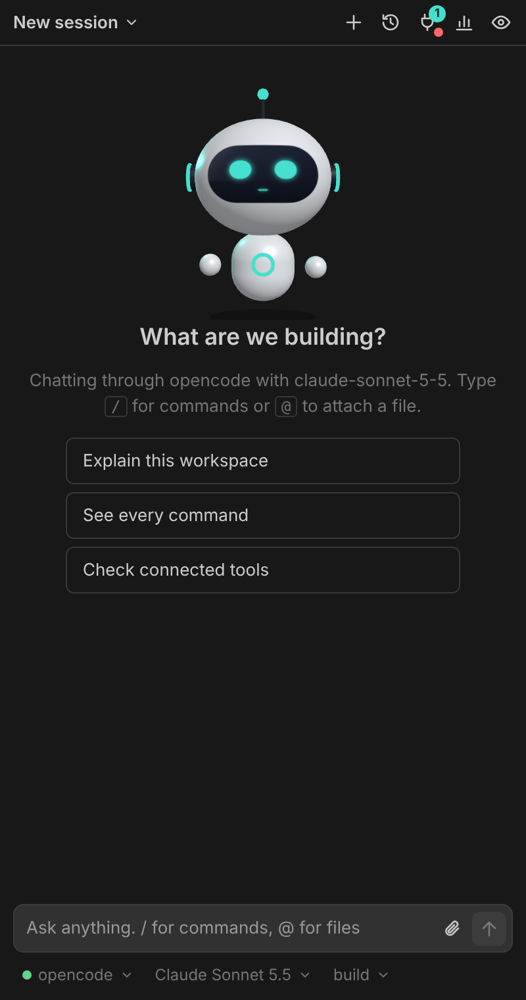

# OpenCode Hub

An open-source chat for VS Code that works with [opencode](https://opencode.ai) first, and also with Claude Code, Codex (ChatGPT), GitHub Copilot, or any OpenAI-compatible or Anthropic model using your own keys.

One chat view, five interchangeable engines, and the same features on all of them: sessions, `/commands`, file attachments, MCP server toggles, token usage statistics and a small 3D companion.

| | |
|---|---|
|  |  |
|  |  |

> This is an independent community project. It is not built by or affiliated with the opencode team, Anthropic, OpenAI, GitHub or Microsoft.

## Engines

| Engine | What it uses | Sign-in |
|---|---|---|
| **opencode** (default) | Your installed `opencode` CLI, started as a local server | Any opencode provider: API keys, or subscription logins such as ChatGPT Plus/Pro and GitHub Copilot through `opencode auth login` |
| **Direct BYOK** | OpenAI-compatible and Anthropic APIs called directly | Your API keys, kept in VS Code Secret Storage. Local servers (Ollama, LM Studio, vLLM, llama.cpp) need no key |
| **Claude Code** | Your installed `claude` CLI | Whatever that CLI is signed in with (Claude subscription or API key) |
| **Codex** | Your installed `codex` CLI | Whatever that CLI is signed in with (ChatGPT subscription or API key) |
| **Copilot / VS Code models** | VS Code's Language Model API | Your GitHub Copilot subscription, plus models other extensions register |

Switch at any time with `/engine` or the engine button under the message box. Each engine keeps its own sessions and model choice per workspace.

## Install

**From a `.vsix` file**

1. Download `opencode-hub-<version>.vsix` from the [Releases page](https://github.com/rohit-chandra/opencode-vs-code-extension/releases).
2. In VS Code open the Extensions view, choose **…** → **Install from VSIX…** and pick the file.
   Or from a terminal: `code --install-extension opencode-hub-<version>.vsix`

Needs VS Code 1.98 or newer. It uses only stable extension APIs, so forks built on that version or later (Cursor, VSCodium, Windsurf) can install it too. The test suite runs on VSCodium 1.98 and on the current release.

**Then set up at least one engine**

- opencode: `npm i -g opencode-ai` (or see [opencode.ai](https://opencode.ai)), then run `/providers` in the chat to connect a provider.
- Direct BYOK: run `/providers`, pick a provider, paste the key.
- Claude Code: `npm i -g @anthropic-ai/claude-code`, run `claude` once in a terminal to sign in.
- Codex: `npm i -g @openai/codex`, run `codex login`.
- Copilot: install and sign in to GitHub Copilot Chat.

Open the chat from the robot icon in the activity bar, or press `Ctrl+Alt+O` (`Cmd+Alt+O` on macOS).

## Features

### Slash commands

Type `/` to see every command, filtered as you type. Commands defined by the engine (opencode custom commands and skills, Claude Code commands) appear in the same list.


| Command | What it does |
|---|---|
| `/new`, `/clear` | Start a new session |
| `/sessions` | Search and switch sessions, rename or delete them |
| `/model [name]`, `/agent [name]`, `/engine [name]` | Change model, agent or engine |
| `/mcp` | Show MCP servers with their status and a toggle each |
| `/usage` | Token usage for this session and overall |
| `/attach` | Attach files |
| `/providers` | Connect providers and manage API keys |
| `/compact`, `/undo`, `/redo`, `/share`, `/unshare`, `/fork` | Session tools, where the engine supports them |
| `/rename <title>`, `/export` | Rename the session, or save it as Markdown |
| `/stop` | Stop the current response (`Esc` also works) |
| `/avatar [on\|off\|bot\|orb]` | Show, hide or restyle the companion |
| `/help` | List all commands |

### Attachments

- Type `@` to search workspace files and attach one.
- Use the paperclip, or drop files on the chat (hold `Shift` when dragging from the Explorer, a VS Code requirement).
- Paste an image from the clipboard.
- Select code and press `Ctrl+Alt+L`, or right-click → **Add Selection to Chat**.

### MCP servers

The plug icon shows how many MCP servers are connected. Open it to see each server's status and switch servers on or off.

| Engine | Where servers are defined | What the toggle does |
|---|---|---|
| opencode | `mcp` in `opencode.json` | Connects or disconnects the server in the running opencode instance |
| Direct BYOK, Copilot | `opencodeHub.mcp.servers` in VS Code settings | Connects or disconnects the extension's own MCP client. Tool calls ask for your approval |
| Claude Code | `.mcp.json`, `~/.claude.json` | Starts the CLI with only the enabled servers |
| Codex | `~/.codex/config.toml` | Passes `mcp_servers.<name>.enabled` for each run |

```jsonc
// settings.json — MCP servers for the Direct BYOK and Copilot engines
"opencodeHub.mcp.servers": {
  "filesystem": { "command": "npx", "args": ["-y", "@modelcontextprotocol/server-filesystem", "${workspaceFolder}"] },
  "docs": { "url": "https://example.com/mcp", "headers": { "Authorization": "Bearer ${env:DOCS_TOKEN}" } }
}
```

`${workspaceFolder}` and `${env:NAME}` are expanded in `command`, `args`, `env`, `cwd`, `url` and `headers`.

### Token usage

Every reply records input, output, reasoning and cached tokens, plus cost when the engine reports it.

- Under each reply: tokens in and out for that reply.
- Under the message box and in the status bar: the running total for the session.
- `/usage`: this session, all sessions, a breakdown by provider and model across every engine, tokens per day and recent sessions.

Statistics are stored locally in VS Code and survive restarts. *OpenCode Hub: Reset Token Usage Statistics* clears them.

Costs come from the engine when it reports them (opencode, Claude Code, and providers that return a cost with their usage, such as OpenRouter). For other BYOK providers you can add prices per million tokens under `pricing` in `opencodeHub.providers`. Copilot does not report usage, so its numbers are estimates from the model's tokenizer.

### The companion

Oki is a small robot drawn with Three.js that reacts to what is happening: thinking, writing, running a tool, waiting for your approval, done, or an error. Click it to switch to a plain orb, use the eye icon or `/avatar off` to hide it. It pauses when the view is hidden, honours *reduce motion*, and falls back to a flat drawing when WebGL is not available.

## Settings

| Setting | Default | Purpose |
|---|---|---|
| `opencodeHub.defaultEngine` | `opencode` | Engine for new workspaces |
| `opencodeHub.opencode.path` | | Path to `opencode` if it is not on `PATH` |
| `opencodeHub.opencode.serverUrl` | | Attach to a running `opencode serve` instead of starting one |
| `opencodeHub.opencode.serverPassword` | | Password of that server |
| `opencodeHub.providers` | `[]` | Direct BYOK providers (no keys here) |
| `opencodeHub.mcp.servers` | `{}` | MCP servers for Direct BYOK and Copilot |
| `opencodeHub.claudeCode.path`, `.permissionMode`, `.models` | `acceptEdits` | Claude Code CLI location, permission mode, extra model names |
| `opencodeHub.codex.path`, `.sandbox`, `.models` | `workspace-write` | Codex CLI location, sandbox policy, extra model names |
| `opencodeHub.avatar.enabled`, `.style` | `true`, `bot` | Companion on/off and style |
| `opencodeHub.usage.statusBar` | `true` | Session tokens in the status bar |
| `opencodeHub.systemPrompt` | | Extra instructions for Direct BYOK and Copilot |

A custom provider looks like this:

```jsonc
"opencodeHub.providers": [
  { "id": "my-vllm", "type": "openai-compatible", "baseUrl": "http://gpu-box:8000/v1", "models": ["qwen3-coder"] },
  { "id": "openrouter", "type": "openai-compatible", "baseUrl": "https://openrouter.ai/api/v1",
    "pricing": { "qwen/qwen3-coder": { "input": 0.2, "output": 0.8 } } }
]
```

## Security and privacy

- API keys for Direct BYOK live in VS Code Secret Storage (your OS keychain), never in settings files. opencode, Claude Code and Codex keep their own credentials; the extension does not read them.
- The opencode server the extension starts listens on `127.0.0.1` only and is protected with a random password for each run.
- Your prompts and attachments go only to the engine and model you selected. The extension has no telemetry and makes no other network requests.
- Model output is sanitized before it is shown. The chat view loads no remote content.
- In an untrusted workspace no engine is started and chat is off, because engines run executables, load project configuration (MCP servers, plugins) and can run tools. Engine settings stored in the workspace (CLI paths, providers, MCP servers) are ignored there.
- Tool permissions: opencode permission requests and MCP tool calls in Direct BYOK and Copilot are shown for approval. Claude Code and Codex run non-interactively, so what they may do is set by `claudeCode.permissionMode` and `codex.sandbox`.

## Limits worth knowing

- Claude Code and Codex cannot ask for approval mid-run in this version; choose their permission mode and sandbox in settings.
- The Direct BYOK and Copilot engines are chat with MCP tools. They do not edit files on their own; use opencode, Claude Code or Codex for agentic coding.
- Direct BYOK does not trim long conversations. Start a new session when a chat gets close to the model's context window.
- Sharing, undo and compaction are available where the engine has them (opencode has all three).

## Development

```bash
npm ci
npm run build          # bundle extension + webview into dist/
npm run watch          # rebuild on change, then press F5 in VS Code
npm run lint && npm run typecheck
npm run package        # → opencode-hub.vsix
```

### Tests

| Command | What runs |
|---|---|
| `npm test` | Unit tests |
| `npm run test:e2e` | Engines and the chat controller against the **real** `opencode`, `claude` and `codex` CLIs, each pointed at a local mock model server. Suites skip when a CLI is not installed |
| `npm run test:ui` | The real webview bundle in headless Chrome, with screenshots in `test-results/ui/` |
| `npm run test:integration` | The extension inside a real VS Code (Linux: `xvfb-run -a npm run test:integration`) |

To run everything locally: `npm i -g opencode-ai @anthropic-ai/claude-code @openai/codex`. No account is needed for any of the tests.

See [docs/ARCHITECTURE.md](docs/ARCHITECTURE.md) for how the pieces fit together and [CONTRIBUTING.md](CONTRIBUTING.md) for how to add an engine.

## Releasing

Push a tag `vX.Y.Z` that matches `version` in `package.json`. The release workflow tests, packages and attaches the `.vsix` to a GitHub Release. If the repository has `VSCE_PAT` or `OVSX_PAT` secrets, it also publishes to the Visual Studio Marketplace and Open VSX.

## Licence

MIT. Bundled third-party packages and their licences are listed in `dist/THIRD_PARTY_NOTICES.txt` inside the extension.
