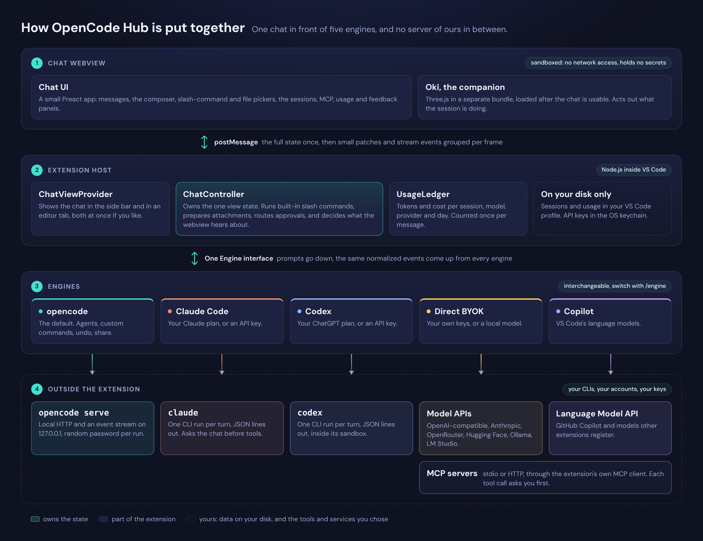
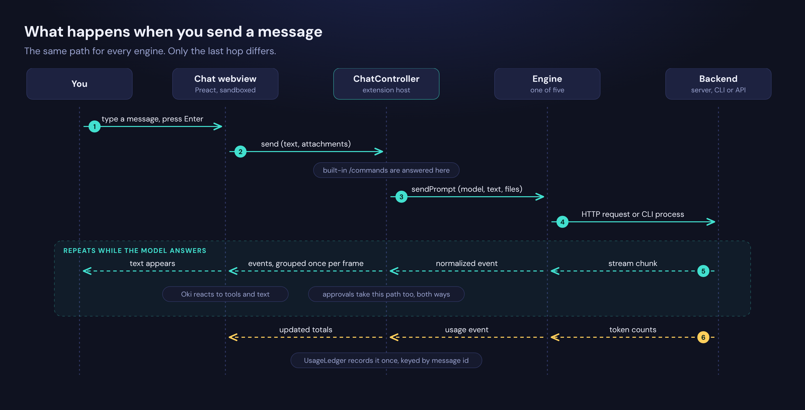

# Architecture

`extension.ts` is the only file that touches the VS Code API on behalf of the rest: it wires VS Code into two small interfaces, `EngineContext` (what an engine needs) and `ControllerHost` (what the chat controller needs: pickers, dialogs, files, the environment). Everything behind those interfaces runs in the tests without an editor.

The diagrams are drawn in `docs/diagrams/*.html` and rendered to PNG with `npm run diagrams`, because the Marketplace page renders neither Mermaid nor SVG.

## Engines

All engines implement `Engine` and emit the same `EngineEvent`s.

| Engine | File | Transport |
|---|---|---|
| opencode | `src/engines/opencode/` | Spawns `opencode serve` (or attaches to one), HTTP for requests, SSE (`/event`) for streaming. opencode owns sessions, tools, permissions, MCP and credentials |
| Direct BYOK | `src/engines/direct/` | `fetch` to `/chat/completions` or `/v1/messages`, SSE streaming, a tool loop over MCP tools |
| Claude Code | `src/engines/cli/claudeCode.ts` | One `claude -p --output-format stream-json` process per turn, `--resume` for continuity |
| Codex | `src/engines/cli/codex.ts` | One `codex exec --json` process per turn, `exec resume` for continuity |
| Copilot | `src/engines/vscodeLm/` | `vscode.lm` chat models, with a tool loop over MCP tools |

The last four extend `LocalEngine` (`src/core/localEngine.ts`), which stores sessions as JSON files in the extension's global storage, scoped per workspace.

## Data flow of one message

1. The webview posts `{ type: 'send', text }`.
2. `ChatController.send` handles built-in slash commands itself; otherwise it makes sure the engine is running, creates a session if needed and calls `engine.sendPrompt` (or `runCommand` for engine commands).
3. The engine emits `message.updated`, `part.updated`, `part.delta`, `session.status` and finally `usage`.
4. The controller applies message events with `applyMessageEvent` (`src/shared/reducer.ts`) and forwards the event itself to the webview, which runs the same reducer. Streaming therefore never re-sends whole messages.
5. `usage` events go to the `UsageLedger`, which is idempotent per message id: history reloads and repeated stream updates only apply the difference.

## Data flow, drawn

## Usage accounting

`TokenUsage` has exclusive buckets: uncached input, output, reasoning, cache read, cache write, and cost. Each engine normalizes its provider's numbers into those buckets (for example OpenAI's `prompt_tokens` includes cached tokens, Anthropic's `input_tokens` does not). The ledger keeps totals per engine/provider/model, per day and per session in VS Code's global state.

What an engine reports is per reply, never a running total. Two CLIs count part of their report from the start of the conversation, and their engines subtract what the conversation had reached before the turn (`src/engines/cli/usageRepair.ts`): `codex exec resume` reports the thread's token counters, `claude --resume` the conversation's `total_cost_usd`. Both were measured against a model server that bills every call the same (`test/e2e/cli.test.ts`). Sessions saved before that was known are rewritten when they are opened.

A reply also carries `contextTokens` (what the last model call read and wrote) and `calls` (how many model calls it took) when the engine can tell. One reply of several calls reads its context once per call, so its usage says nothing about the size of the context; the context ring uses `contextTokens`. The webview shows new input, cache reads and output separately and leaves cache reads out of totals (`webview/src/format.ts`, `usedTokens` in `src/shared/types.ts`).

When a local engine (`LocalEngine`) finishes a turn with tokens but no cost, it asks its `listPricing(model)` hook for a price and estimates the cost. Direct BYOK answers with the price from settings or, for providers recognised by their API host, from `src/core/prices.json`; Codex answers with OpenAI's list price. The table is generated by `scripts/update-prices.mjs` from the model catalog the opencode CLI carries, so the extension never downloads prices.

## Long conversations in Direct BYOK

`src/engines/direct/context.ts` keeps a request inside the model's context window. The whole transcript stays in `session.meta.wire`; `session.meta.wireStart` is where sending starts. When a provider rejects a request as too long (`isContextOverflow`), `dropOldestTurns` moves the start forward by whole turns, so a tool call is never separated from its result, and the request is sent again. `opencodeHub.direct.maxContextTokens` applies a budget before sending instead.

## Feedback, diagnostics and context from other sessions

- `src/shared/feedback.ts` builds a link to a pre-filled GitHub issue form (`.github/ISSUE_TEMPLATE/*.yml`; the query parameters are the field ids) and the diagnostics text. The controller opens the link in the browser; the extension sends nothing itself. `/doctor` prints the same facts, plus engine details, into the chat as a local message.
- Messages the controller writes itself have ids starting with `local_`. They are shown as closable cards, are never sent to an engine and are left out of exports and digests.
- `src/core/sessionDigest.ts` condenses a saved session without calling a model. `ChatController.attachSession` attaches the digest to the next message as an ordinary text attachment, so every engine handles it the same way.

## Where the chat is shown

`ChatViewProvider` (`src/ui/chatView.ts`) can show the same chat on two surfaces at once: the side bar view `opencodeHub.chat` and an editor tab (`WebviewPanel` of type `opencodeHub.chatPanel`, restored after a reload through a `WebviewPanelSerializer`). Every message from the controller is posted to all open surfaces, and the controller is told the webview is gone only when the last one closes.

The view is contributed to an activity bar container (`opencodeHub`) and a second, empty container in the secondary side bar (`opencodeHubSecondary`). Moving left or right is `vscode.moveViews` with the container as destination. VS Code registers a command named `workbench.view.extension.<containerId>` for every contributed container, which is how the extension detects at run time whether the editor supports secondary side bar contributions; where it does not, it falls back to VS Code's own *Move View* picker.

## Webview

- `webview/src/store.ts` mirrors `ViewState`; the host sends a full `state` once, then `patch`es and streaming `event`s. Stream events are queued on the host for up to 16 ms and sent as one `events` message; the store notifies subscribers at most once per animation frame.
- `webview/src/markdown.ts` splits a reply into top-level blocks and caches the rendered HTML of each, so a streaming reply re-parses only its last block. `Messages.tsx` memoizes messages and blocks, so finished ones are not rendered again.
- Markdown is rendered with marked and sanitized with DOMPurify. Links never navigate: clicks are posted to the host, which opens files in the editor or URLs in the browser.
- The content security policy allows only the extension's own scripts and styles and `data:`/`blob:` images.
- `webview/src/avatar/` is a separate bundle (Three.js) loaded after the chat is interactive.

## The companion

`webview/src/hooks.ts` turns the view state into a mood (`deriveMood`): it watches tool parts change status during a turn, and when the activity returns to idle it looks at the whole turn (every assistant message after the last user message) to decide between happy, excited and sad. One-off reactions (a tool finished, a tool failed, a poke) are queued separately and played on top of the current mood.

`webview/src/avatar/index.ts` builds the character in code (a body of revolution from `blobGeometry`, plus spheres for ears, hands and feet), draws the face on a canvas texture (`face.ts`) and animates everything with springs towards per-mood pose targets. `particles.ts` is a fixed pool of sprites for sparks, confetti, tears and the like. Rendering is demand-driven: a frame budget per mood, no frames while the document is hidden, the canvas is off screen or the host reports the view as hidden, and a 2D canvas fallback when WebGL is missing. `test/ui/gallery.html` shows every mood side by side.

## Tests

| Layer | Location | Notes |
|---|---|---|
| Unit | `test/unit` | Parsers, reducers, mapping, ledger, translators, feedback links, list prices, context trimming |
| End to end | `test/e2e` | Real `opencode`, `claude`, `codex` processes against `test/fixtures/mock-llm.mjs` and `mock-mcp.mjs` |
| UI | `test/ui` | Real webview bundle in headless Chrome with a mocked `acquireVsCodeApi` |
| Integration | `test/integration` | Inside VS Code through `@vscode/test-electron`, on Linux, macOS and Windows in CI |

## Send later

Scheduled messages belong to the controller (`ChatController.schedule`, `deliverDue`), not to an engine. They are part of the view state (`ViewState.scheduled`) and are saved through `ControllerHost.state`, which is VS Code's storage scoped to the workspace folder. One timer waits for the next message that is due. Delivering a message opens its conversation (engine and session) and calls the same code path as the Send button, so approvals, questions, slash commands and usage accounting need nothing of their own. Nothing is delivered while the conversation on screen is busy; the end of a reply (`session.status` going idle) calls `deliverDue` again, which is what turns "send when this reply is done" into a queue. Reading a time the user typed, the presets and the labels are pure functions in `src/shared/sendLater.ts`, shared with the webview.

## HTML previews

A fenced block with the language `html-preview` is drawn instead of shown as code (`webview/src/preview.ts`); `/preview <request>` asks a model for one by appending instructions after a marker (`src/shared/htmlPreview.ts`), which the chat hides when it shows the request. The markup goes through DOMPurify with a stricter configuration than Markdown, its stylesheets are scoped, and it is mounted in a shadow root inside an element with `contain: content`, so neither its CSS nor a positioned element can reach the chat around it. A block that is still streaming stays code until its fence is closed.
